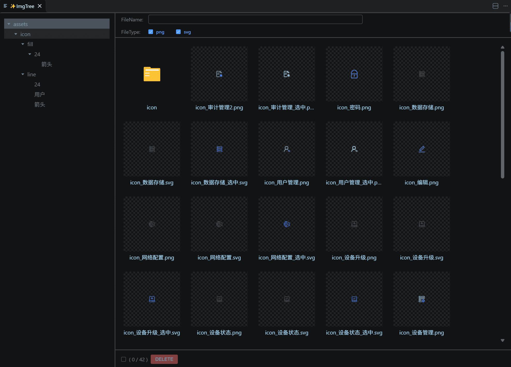
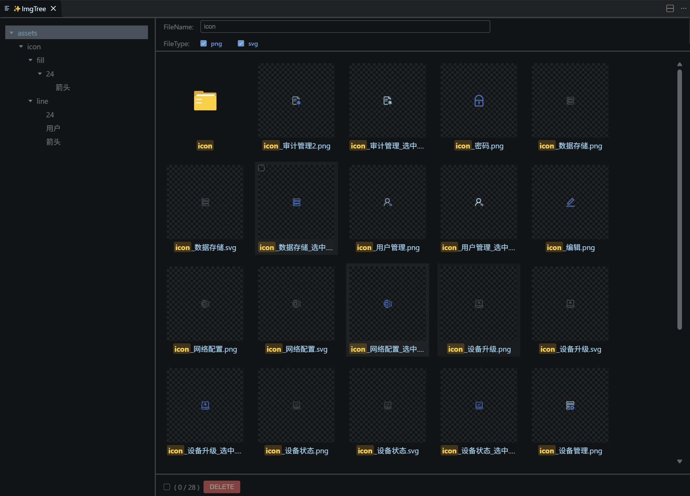
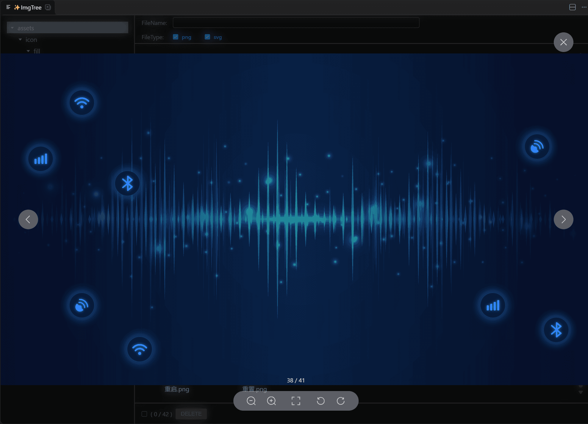
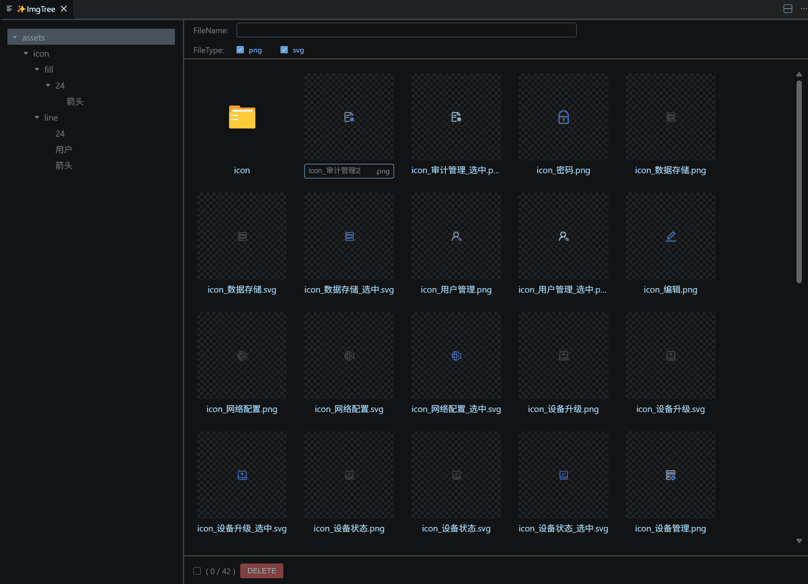
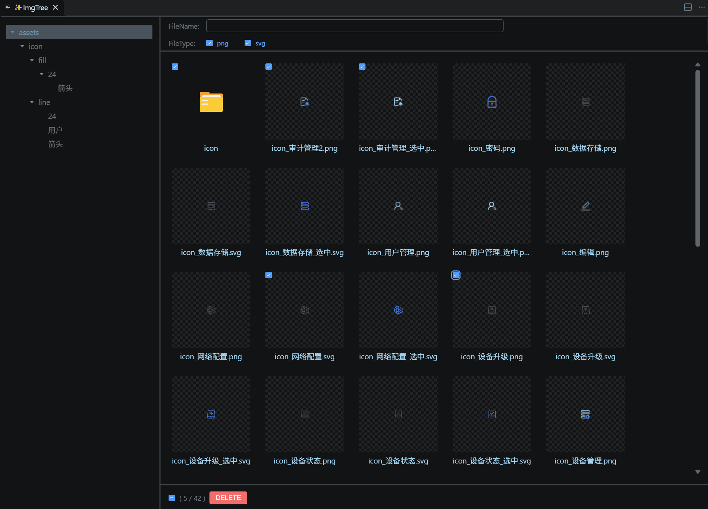
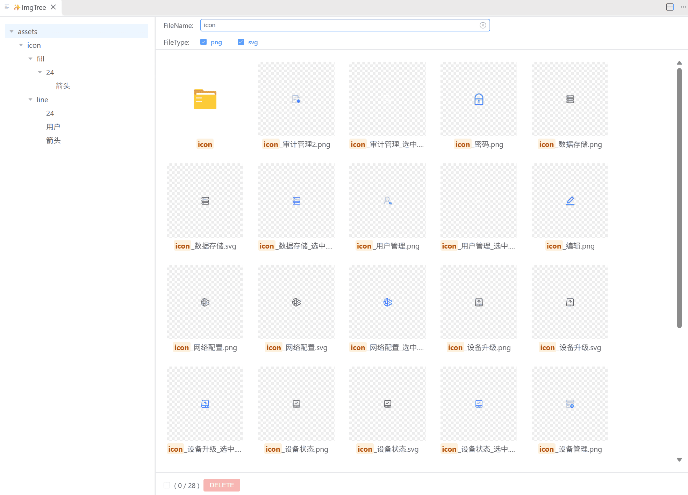
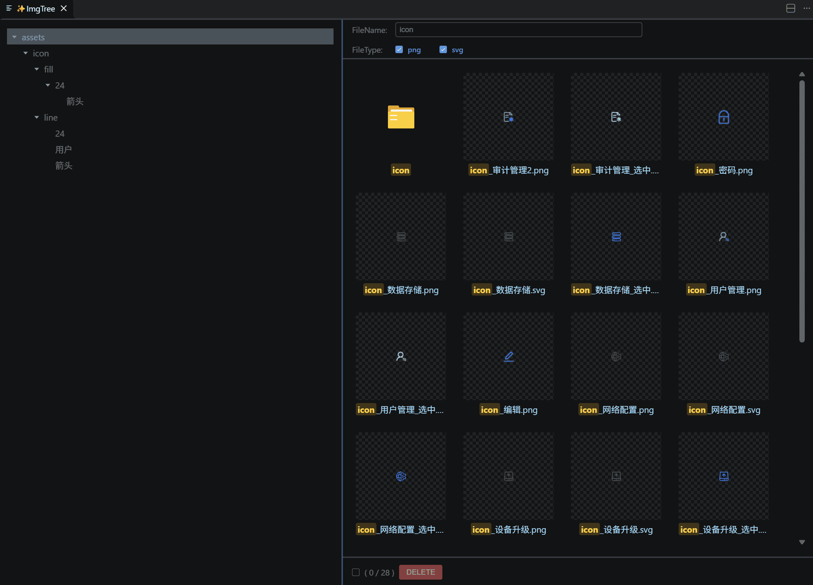
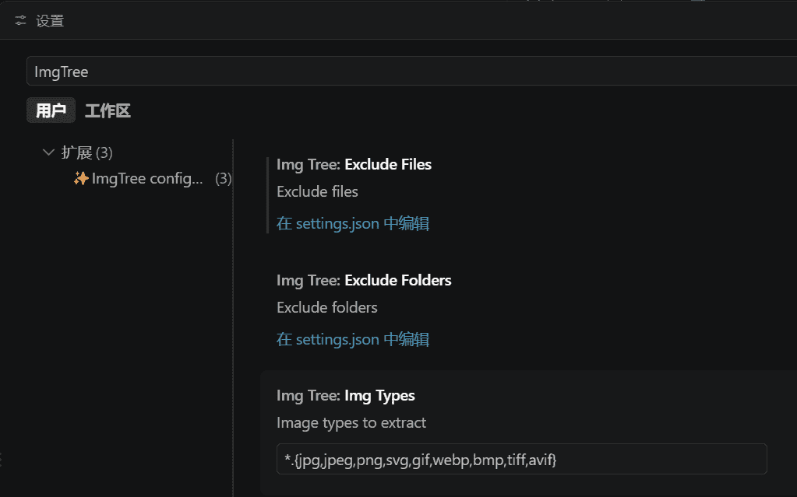

# ImgTree

Visual Image Explorer for VS Code

**English** | [简体中文](README.zh-CN.md)

It started with a simple pain point: Windows can't preview SVG files, which makes browsing and finding the many SVG icons in a project a headache. ImgTree was born for this — browse, search and manage project images inside VS Code with a directory tree and thumbnails, with support for common image formats along the way.

## Features

### 1. Overview

Folder tree navigation on the left, image thumbnails on the right — everything at a glance

### 2. Filtering

- Filter by file type (multi-select)
- Real-time name filtering with keyword highlighting

### 3. Image Preview

Click an image for fullscreen preview, with multi-image navigation and zoom

### 4. Rename

Right-click a file/folder name for an inline rename: the current name is prefilled and focused (extension omitted for files), press `Enter` to commit or `Esc` to cancel; clicking elsewhere commits as well

### 5. Multi-select & Batch Delete

- Hover an item to reveal its checkbox; select-all and indeterminate states supported
- Files and folders can be mixed freely, then removed in batch with `DELETE`
- Deleted items go to the OS trash, so they are recoverable

### 6. Live Sync

While the panel is open, the selected folder is watched continuously: any change — created, deleted, renamed, or made by external tools — is reflected in the tree, the list and the type options in real time (changes inside `excludeFolders` do not trigger a refresh)

### 7. State Memory

The last browsed folder, selected file, keywords and type filters are remembered and restored when the panel reopens

### 8. Quick Actions

- Double-click a folder in the list to enter it
- Click a file/folder name to copy it to the clipboard

### 9. Dark/Light Theme

Follows your VS Code theme automatically

### 10. Resizable Panels

Drag the splitter to freely adjust the width of the folder tree and the file list

### 11. Configuration

Customize excluded folders, excluded files and image formats in VS Code Settings

| Setting                  | Description      | Default                                       |
| ------------------------ | ---------------- | --------------------------------------------- |
| `ImgTree.excludeFolders` | Excluded folders | `["**/node_modules"]`                         |
| `ImgTree.excludeFiles`   | Excluded files   | `[]`                                          |
| `ImgTree.imgTypes`       | Image formats    | `*.{jpg,jpeg,png,svg,gif,webp,bmp,tiff,avif}` |

## Usage

1. Right-click any folder in the VS Code Explorer
2. Choose the **ImgTree** command
3. Browse and manage all images under that folder in the opened panel

> Running the command again on the same folder reuses the existing panel instead of creating a duplicate

## License

[MIT](LICENSE)
