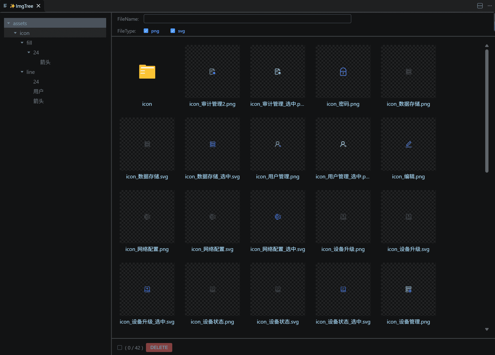
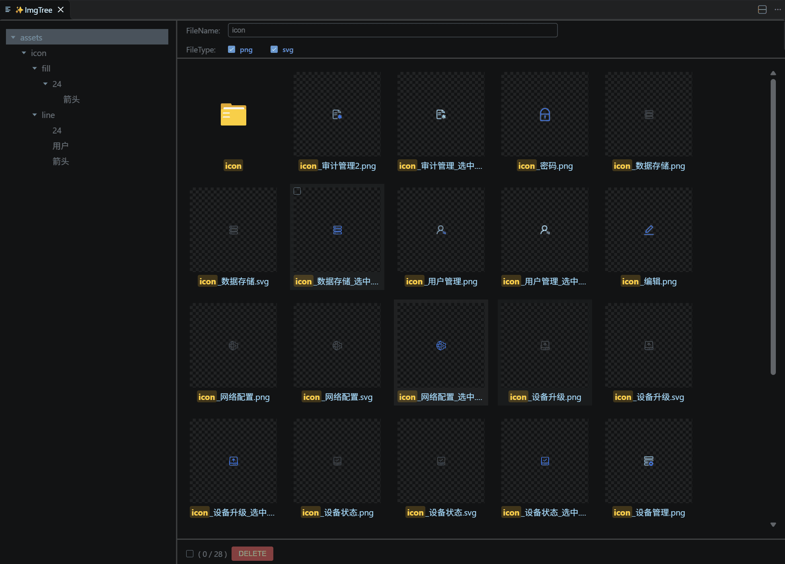
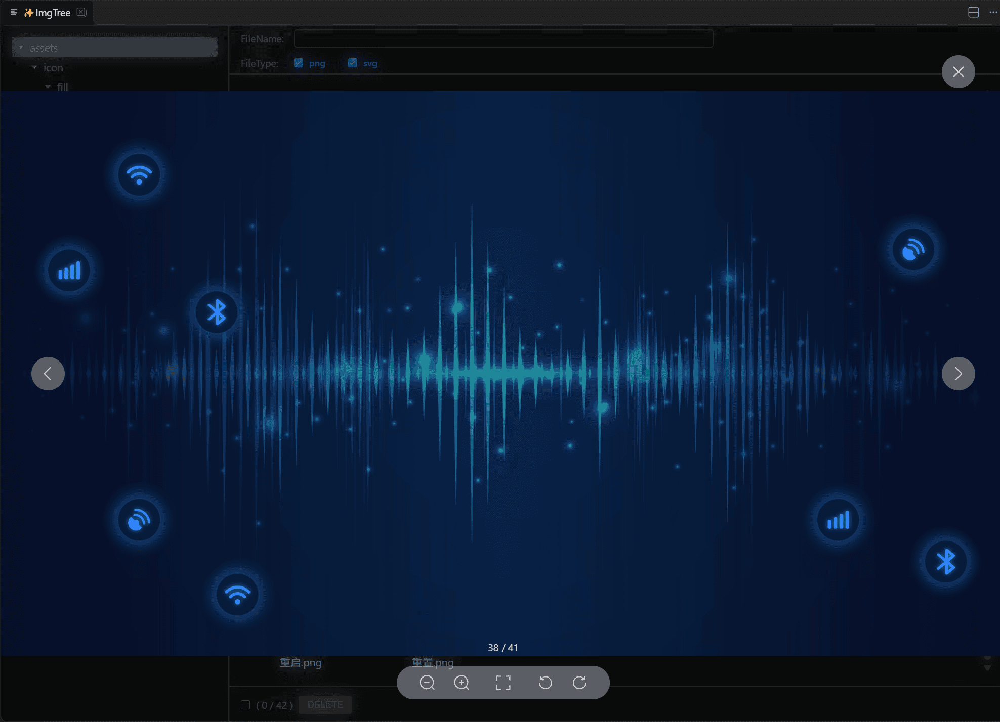
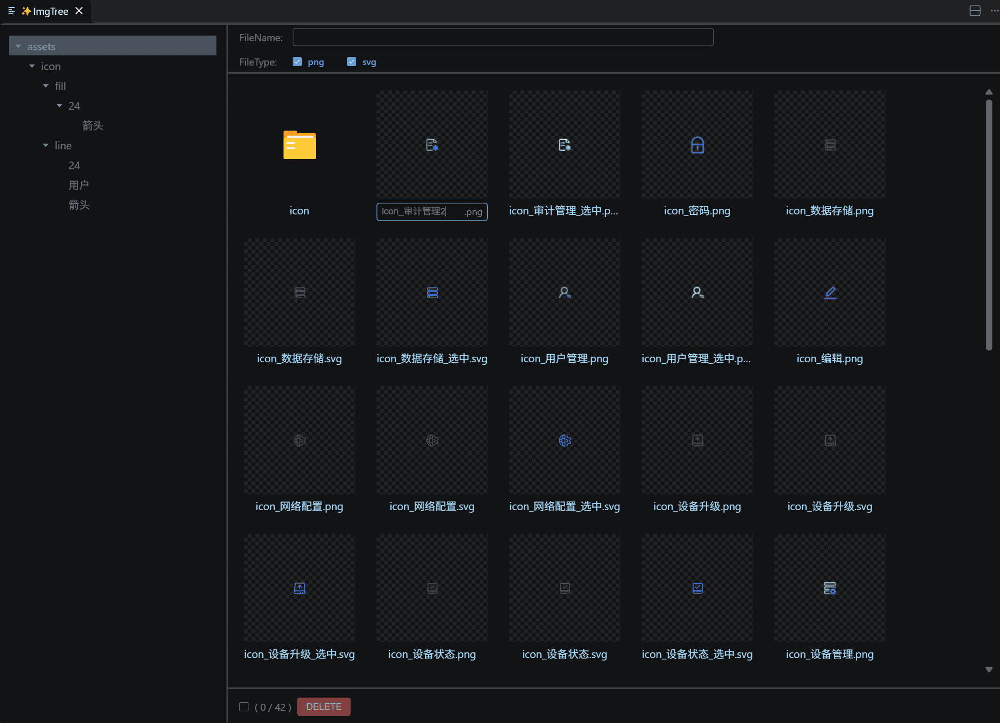
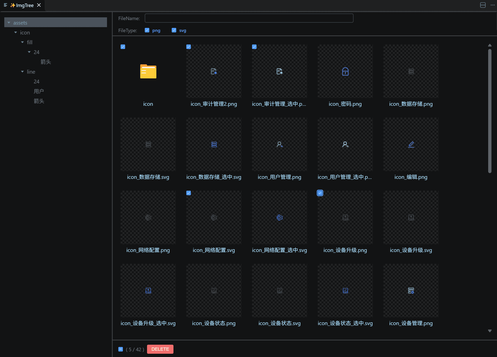
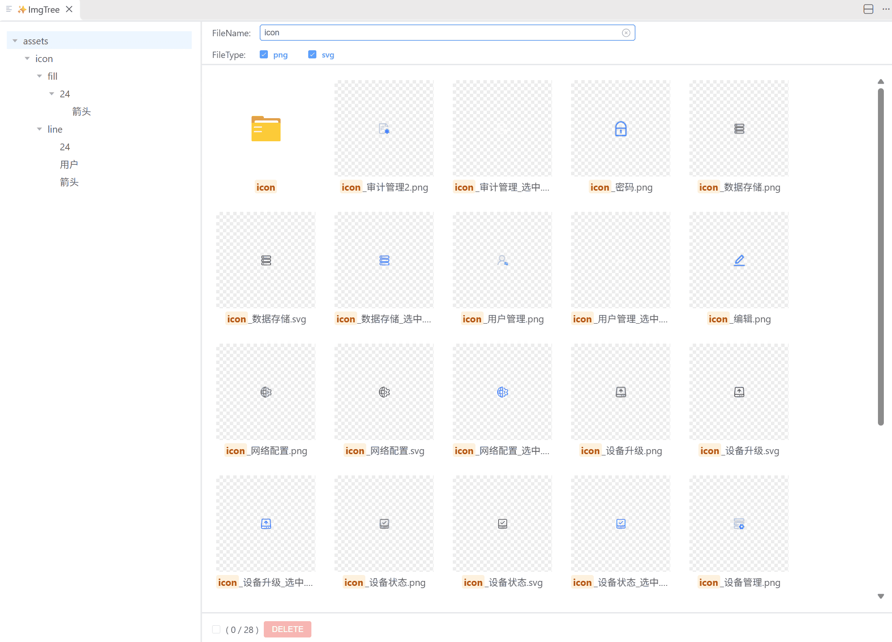
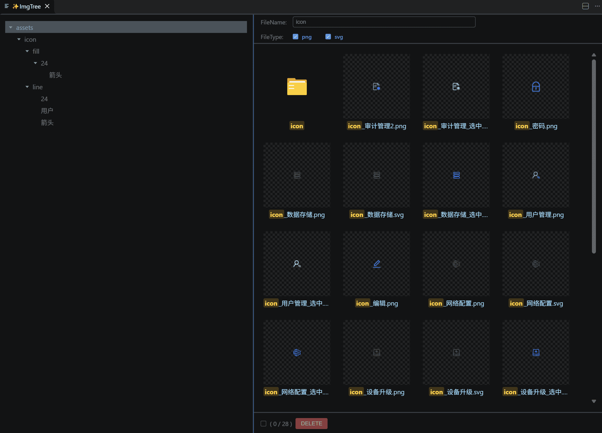
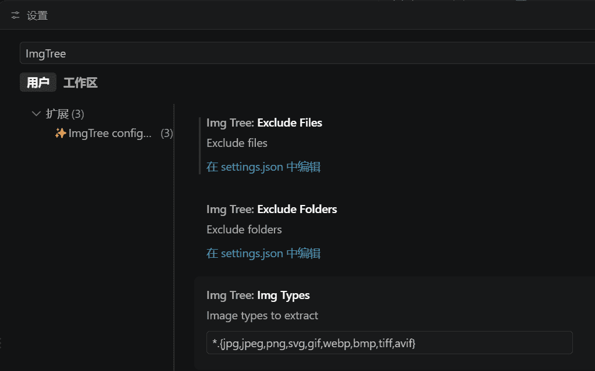

# ImgTree

Visual Image Explorer for VS Code

[English](README.md) | **简体中文**

起初只是为了解决一个痛点：Windows 下无法直接预览 SVG，项目里数量众多的 svg 图标难以浏览和查找。于是有了 ImgTree —— 在 VS Code 中以目录树 + 缩略图的方式浏览、查找和管理项目图片，并顺带支持常见的图片格式。

## 功能特性

### 1. 概览

左侧文件夹树形导航，右侧图片缩略图，一目了然

### 2. 文件过滤

- 文件类型多选
- 文件（夹）名实时过滤，匹配文字高亮显示

### 3. 图片预览

点击图片可全屏预览，支持多图切换和缩放操作

### 4. 重命名

右键文件（夹）名进入内联重命名：自动预填原名并聚焦（文件自动略去扩展名），`Enter` 提交、`Esc` 取消，直接点击其他位置等同提交

### 5. 多选与批量删除

- 悬停条目显示勾选框，支持全选 / 半选
- 文件与文件夹可混选，`DELETE` 批量删除
- 删除移入系统回收站，可从回收站找回

### 6. 实时同步

面板打开期间持续监听所选文件夹：新增、删除、重命名或外部工具产生的任何变化，都会实时反映到目录树、列表和类型选项中（`excludeFolders` 内的变化不触发刷新）

### 7. 状态记忆

自动记住上次浏览的目录、选中的文件、关键词与类型筛选，重新打开面板时无缝恢复

### 8. 快捷操作

- 双击列表内的文件夹直接进入
- 单击文件（夹）名复制名称到剪贴板

### 9. 深色/浅色主题切换

自动跟随 VS Code 主题

### 10. 面板宽度调整

拖动分割线自由调整文件夹树和文件列表的宽度

### 11. 配置项

在 VS Code 设置中可自定义排除的文件夹、文件和图片格式

| 配置项                   | 说明           | 默认值                                        |
| ------------------------ | -------------- | --------------------------------------------- |
| `ImgTree.excludeFolders` | 排除的文件夹   | `["**/node_modules"]`                         |
| `ImgTree.excludeFiles`   | 排除的文件     | `[]`                                          |
| `ImgTree.imgTypes`       | 支持的图片格式 | `*.{jpg,jpeg,png,svg,gif,webp,bmp,tiff,avif}` |

## 使用方法

1. 在 VS Code 资源管理器中，右键点击任意文件夹
2. 选择 **ImgTree** 命令
3. 在打开的面板中浏览、管理该文件夹下的所有图片

> 对同一文件夹重复执行命令会复用已打开的面板，不会重复创建

## License

[MIT](LICENSE)
